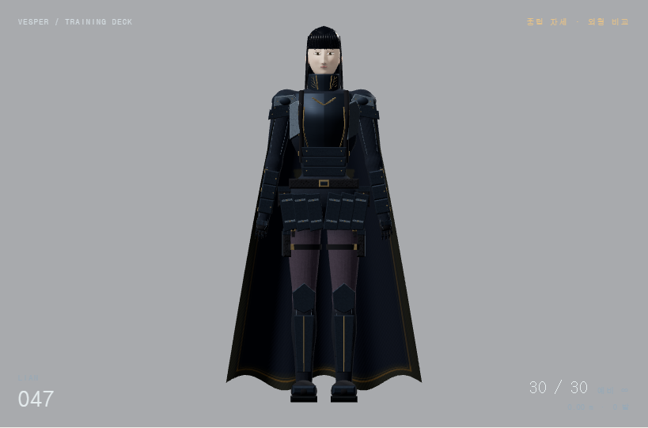
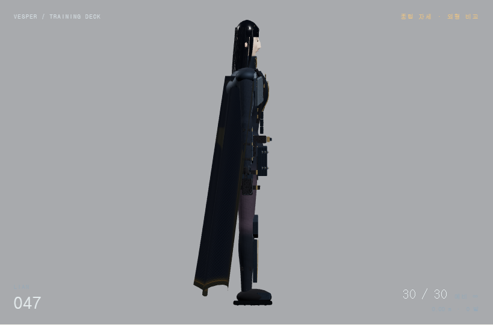
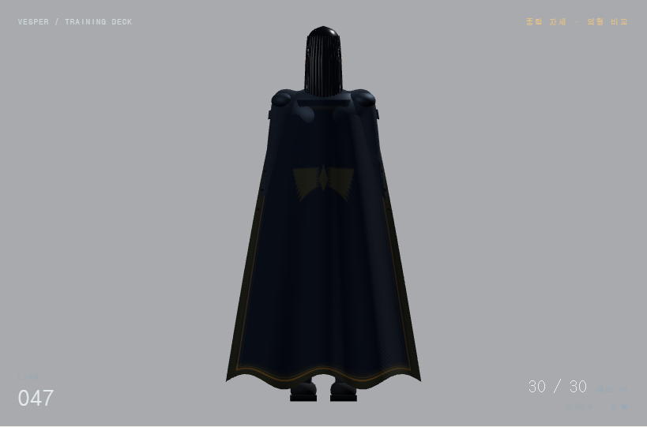

# 플랜 F 리안 · 변형 오류와 전신 비례 002

2026-11-12 KST · 제한된 동작/렌더 검사 통과 · **원화 일치도·미감은 사용자 검수 대기**

[중립 자세 실행](http://127.0.0.1:4173/#/samples/characters/clone_01?plan=f&fPose=neutral&fYaw=90&fPitch=0) · [기준 원화](../../../concepts/reference_003_3d/source/appearance.png) · [이전 디테일 구현](../human_detail_001/README.md)

사용자의 “수정하지말고 … 랜더와 실제 원화를 비교해봐” 이후 비교에서 확인한 문제를 바탕으로, 다음 순서를 제안했다. 사용자의 “그렇게 해줘”에 따라 **① 명백한 변형 오류 → ② 비교용 중립 자세 → ③ 큰 비례와 실루엣**까지 구현하고 실제 렌더를 확인했다. 얼굴·헤어의 세부 재설계와 원화 수준의 갑옷 제작까지 완료했다는 뜻은 아니다.

## 바뀐 부분

- **팔에서 늘어나는 검은 면:** 바인드 자세의 아래팔이 골반 높이에 있다는 사실을 무시한 높이 기반 가중치 때문에, 전완 정점 일부가 가슴에 묶여 있었다. 실제 팔 축까지의 거리와 축 방향 위치로 분류하도록 고쳤다. 아래팔 말단 표본 1,290개 정점의 가슴 가중치는 0이다.
- **정수리의 흰 부분:** 머리 덮개를 뒤로 0.012m 이동시켜 앞쪽 두피가 얼굴 표면 안으로 들어가 있었다. 뒤쪽 이동을 없애고 두개골을 감싸는 단면과 꼭대기를 다시 잡았다. 정면·측면 캡처에서 이전의 흰 빈 부분이 보이지 않는다. 작은 밝은 반사광까지 없앤 것은 아니다.
- **머리와 몸:** 머리를 0.79배로 줄이고 위치를 조정했다. 머리 축소가 목 외피에 전달되지 않도록 스키닝 드라이버의 스케일을 분리했다. 중립 자세의 설계 치수는 정수리 높이 약 1.693m, 정수리–턱 약 0.237m로 약 7.14등신이다. 원화의 약 7~7.5등신이라는 육안 참고 범위를 사용했으며 정확한 3D 복원이나 픽셀 정합 측정값이 아니다.
- **전신 윤곽:** 어깨 기준 폭을 0.390→0.350m로 줄이고 견갑 크기, 흉곽·허리 폭, 골반·허벅지·종아리·발목 굵기를 조정했다. 팔·다리 길이와 기존 IK/장전 시간은 유지한다. 흉갑 삽입판·스트랩·버클 위치와 정강이 판금을 조정된 외피에 맞췄다.
- **망토 윤곽:** 생성 길이를 1.15→1.27m, 밑단 폭을 0.68→0.88m로 늘리고 측면 감싸기와 주름·밑단 높이 변화를 조정했다. 발목 가까이 내려오는 넓은 실루엣으로 바뀌었다. 기존 단순 바닥 제한은 유지하며 천 충돌/시뮬레이션을 새로 구현하지 않았다.

## 비교 모드

기존 플랜 F에 **중립 자세 비교 / 전투 자세로**, **정면 / 측면 / 후면** 버튼을 추가했다. 중립 자세는 총을 숨기고 팔을 내려 편 손으로 서며, 회색 배경·백색 조명·동일한 수평 정사영으로 큰 형태를 확인한다. 환경 반사와 화면 후처리는 이 보기에서 제외된다. 전투 자세로 돌아가면 기존 환경과 조명·반사·후처리 설정을 복구한다.

중립 보기 동안 시뮬레이션 시간을 진행하지 않고 이동·사격·앉기·장전 입력을 막는다. 위치·탄수·앉기·진행 중 장전 상태는 리셋하지 않는다. 중립 자세 자체는 상태를 읽기만 한다. 입력 래치와 남은 효과는 전환 때 비운다. 카메라 선택은 유지하고 `fPose=neutral`로 주소에서 복원한다. 정면/후면 버튼은 마지막 이동 방향을 고려한다.

## 실제 렌더와 판단

다음은 AI가 그린 목표 이미지가 아니라 현재 JavaScript/Three.js를 실행한 Chromium 캡처다. 원화는 비대칭 포즈·원근·조명을 가진 그림이므로 중립 렌더와 픽셀 단위 일치율을 계산하지 않았다.

| 정면 | 측면 | 후면 |
|---|---|---|
|  |  |  |

[이전 정면](reviews/before-front.png) · [이전 측면](reviews/before-side.png) · [견착 정면](reviews/combat-front.png) · [견착 측면](reviews/combat-side.png) · [앉기 측면](reviews/crouch-side.png)

이전 정면은 작업 전 비교 턴의 캡처를 보존한 것으로 화면 배율·조명·자세가 중립 보기와 다르다. 변형 오류의 전후 증거로 사용하며 비례의 정밀 정합 자료로 사용하지 않는다. 첫 보정 결과는 `reviews/iteration_01/`에 보존했고, 버클 위치와 망토 윤곽을 한 차례 더 조정한 뒤 최종 캡처를 저장했다.

**개선 확인:** 팔에서 길게 뻗던 면과 흰 정수리 노출이 사라졌다. 큰 머리·둥근 어깨의 과장이 줄었고 종아리와 발목에 굵기 차이가 생겼다. 망토는 더 길고 넓어졌다. 중립 보기로 전신 윤곽을 무기에 가리지 않고 확인할 수 있다.

**남은 차이:** 얼굴은 아직 원화의 눈매·코·입술·턱 윤곽을 재현하지 못한다. 머리는 매끈한 덮개와 규칙적인 다발이 강해 가발처럼 보인다. 흉갑·복부 판금은 단순하고, 다리 갑옷도 넓은 평판 느낌이 남는다. 망토의 어깨 연결과 큰 굽힘, 옷·머리·장비 간 관통도 추가 작업 대상이다. 그러므로 “원화 재현 완료”가 아니라 오류 제거와 큰 형태를 검토할 기반을 만든 버전으로 판단한다.

## 수행한 검증

기존 검증 생략 방침 이후, 이번에는 실제 렌더로 비교하자는 계획을 사용자가 승인했으므로 해당 범위의 확인을 수행했다. 내장 브라우저 연결이 `sandboxPolicy` 누락 오류로 시작되지 않아 설치된 Python Playwright/Chromium을 사용했다. 원본 페이지와 공용 런타임 모듈을 그대로 실행했다.

- `reviews/capture.py`: 중립 3방향·견착 2방향 캡처, 콘솔/페이지 오류 없음.
- `reviews/verify-body.js`: 중립·대기·이동 사격·좌향 앉기·빈 탄창 장전의 13개 표본 자세 검사. 외피 정점 좌표가 유한하고, 변형 후 삼각형의 가장 긴 변은 약 0.059m로 회귀 감지 한계 0.14m 이내. 이는 늘어난 면의 회귀 검사이며 피부/장비 무관통 증명이 아니다. 빈 탄창 장전 완료 후 30발 복구, 중립 자세 호출 전후 상태 보존 확인.
- `reviews/check-controls.py`: 주소 복원, 중립 중 전투 입력 차단, 일시정지 중 앉기, 중립 왕복 후 앉기 유지, 단발 후 29발, 왼쪽 이동, 왼쪽 진행 시 정면 버튼 −90°, URL 기록을 실제 UI로 확인. 페이지 오류 없음.
- 변경한 JavaScript의 구문과 새 기록의 파일/해시/문서 연결 확인. 전 플랫폼 성능·장시간 연사·모든 관절 각도·정밀 파지/천 충돌 검사는 범위 밖이다.

정량 원본은 [body-checks.json](reviews/body-checks.json), [control-checks.json](reviews/control-checks.json), [browser-errors.json](reviews/browser-errors.json)에 있다. 자동 검사 통과와 아트 채택을 구분한다.

## 다음 제작 순서

1. 현재 중립 렌더를 기준으로 비례 피드백을 반영한다. 큰 비례가 달라지면 장식 추가보다 먼저 수정한다.
2. 얼굴의 눈/코/입/턱 위치와 앞머리 덩어리·가르마·옆머리 윤곽을 원화에 맞춘다. 더 많은 가닥이나 광택만 추가하지 않는다.
3. 흉갑·복부·견갑·하의·부츠를 원화의 판금 분할과 겹침에 맞추고, 손 파지와 망토 부착/관통을 정리한다.
4. 마지막으로 재질과 조명을 조정하고 동일 중립 보기 및 이동·앉기·장전에서 재검토한다.

## 보존과 제작 방식

`before/`는 작업 시작 시 소스, `source_snapshot/`은 최종 런타임, `reviews/`는 캡처·검사 코드·결과다. [record.json](record.json)에 입력·해시·시간·검수 상태를 남긴다. 별도 모델/모션 로딩이나 이미지 생성 없이 JavaScript 생성 경로를 유지한다. 공통 목록에 `plan_f_human_proportion_002`를 추가하며 채택 원화 선택은 그대로 둔다.
