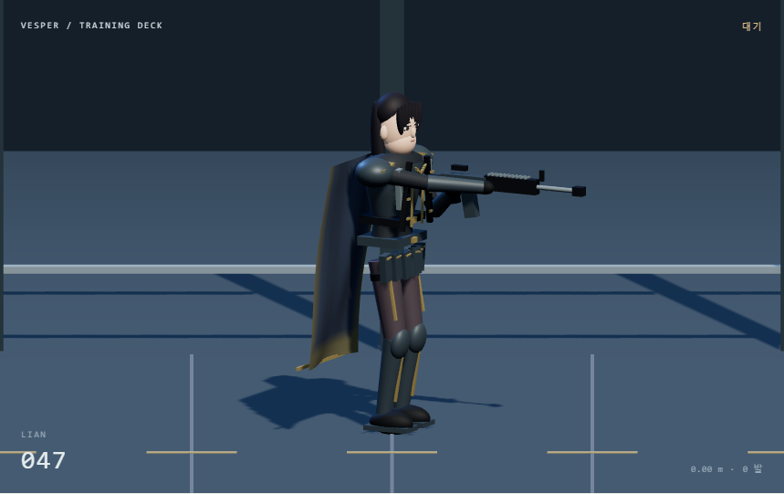
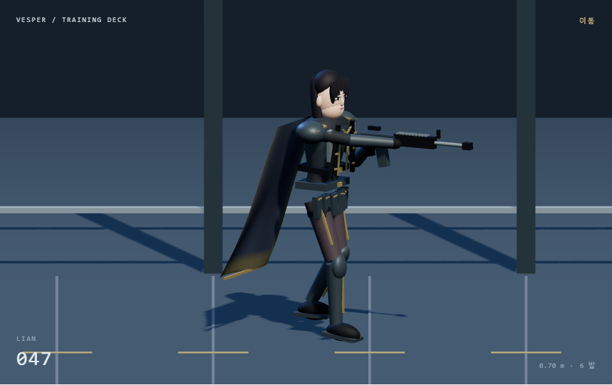

# 플랜 F 001 리안 이동과 사격

제작일: 2026-11-12 KST. 상태: 조작·표시 확인, 외형 및 동작 사용자 검수 대기.

[실행](http://127.0.0.1:4173/#/samples/characters/clone_01?plan=f)

사용자 요청은 플랜 F 방식으로 클론01이 총을 쏘고 움직이며 격투게임과 비슷한 시점으로 표시하는 것이다. 기존 리안 페이지에 플랜 F 탭과 모션 목록을 연결했다. `python tools/preview_server.py --port 4173`으로 서버를 실행한다.

## 구현

- 캐릭터·갑옷·머리·망토·소총·바닥·배경을 JavaScript 지오메트리로 생성한다. Three.js r187 외에 모델·텍스처·애니메이션 파일을 사용하지 않는다.
- 긴 검은 머리·금속 갑옷·금색 장식·망토·짧은 장갑 스커트·긴 부츠를 참고 원화에서 가져왔다. 얼굴·실루엣은 절차 생성 첫 시안이며 채택 원화와 동일한 품질을 주장하지 않는다.
- 약간 내려다보는 정사영 카메라와 몸을 조금 돌린 측면으로 전신을 표시한다. A/D 또는 화살표 좌우 이동, Space/J 연사, Esc 일시정지. 화면과 길게 누르는 버튼도 사격을 지원한다.
- 고정 60Hz에서 이동과 초당 10발 발사 이벤트를 처리한다. 이동 중 사격 가능, 탄약 무제한. 발사 횟수·위치·현재 상태를 표시한다.
- 보행 주기·무릎 굽힘·양팔 접점·머리카락·망토 움직임을 코드로 계산한다. 발사 이벤트로 반동·총구광·탄도를 표시하며 총성은 Web Audio 노이즈 합성이다. 총성은 사용자가 켜는 옵션이다.
- 버튼 해제·포커스 이탈 시 입력을 비운다. 다른 탭으로 이동하면 프레임 루프를 중지하며 브라우저 탭이 숨겨지면 일시정지한다.

적·피해 판정·장전·점프·스테이지 클리어는 이번 동작 시험 범위에 포함하지 않는다. 원본 GLB와 기존 A~E는 수정하지 않았다. 코드는 `game/plan-f/`의 model·simulation·stage·index·styles로 나뉜다.

## 확인 결과

`tools/review_plan_f.py`가 로컬 Chrome에서 실제 키보드·포인터 입력으로 양방향 이동, 이동 사격, 해제 후 발사 중단, 정지 중 위치/발사 횟수 보존, 초기화, 탭 전환·복귀, 좁은 화면 표시를 확인했다. 페이지 JavaScript 오류와 외부 모델 요청은 0건이다. [기록](review/result.json).

공통 라이브러리는 채택 원화를 별도로 읽지만 F 캐릭터·총·배경 렌더러는 그 이미지를 사용하지 않는다. 넓은 화면의 대기·이동 모습은 시각적으로 확인했다. 음향 청취 품질·다른 브라우저·60fps 성능 보장은 검증하지 않았다.

## 제한과 제작 기록

손가락·얼굴 세부·옷의 충돌·망토의 물리 시뮬레이션은 정밀 구현이 아니다. 보행 접지는 단순 주기식이며 짧은 시각 확인이 완성 모션 채택을 의미하지 않는다. 소총은 코드 생성 동작 시험용 형상으로, 정식 무기 모델이나 설정 변경이 아니다.

내장 이미지 생성·외부 모델 생성 호출은 0회다. 기존 원화는 시각 참고만 했다. 생성 입력은 사용자 요청과 코드이며 정확한 소스 해시·기록 시각·도구는 [제작 기록](record.json)에 저장한다. 작업 시작·종료 사이의 정확한 총 소요 시간과 비용은 측정하지 않았다.
