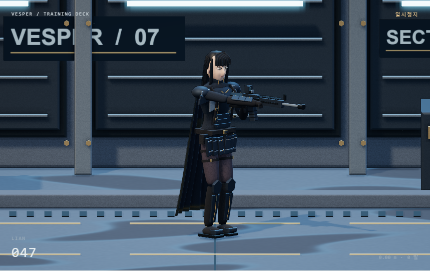
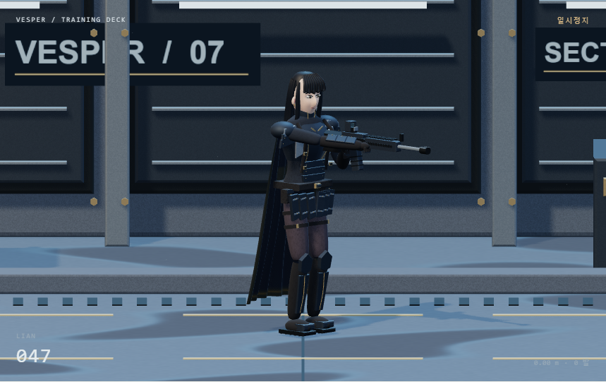

# 플랜 F 002 모델과 렌더링 개선

2026-11-12 KST · 기능·화면 확인, 외형 사용자 검수 대기.

[실행](http://127.0.0.1:4173/#/samples/characters/clone_01?plan=f) · [이전 001](../procedural_001/README.md)

## 소스 조사와 적용 판단

사용자가 준 [Saltline](https://github.com/realcodebear/saltline-fable-5.2/tree/09c51774cd77aad750bd2d6c42af2b1020cb668d)을 플랜 F 참조 폴더에 클론했다. 정확한 경로·재현 명령·커밋은 [참조 안내](../../../../../../game/plan-f/reference/README.md)에 있다. 아래 판단을 먼저 하고 우리 r187 코드로 구현했다. 참고 프로젝트의 전체 게임 코드는 이식하지 않았다.

| 조사한 기법 | 소스 위치 | 우리 적용 |
|---|---|---|
| 절차 생성 PBR 재질과 캐시 | `Gg`, albedo/ORM/normal 렌더 타깃 | 시드 고정 DataTexture로 albedo·roughness·normal을 생성·캐시. 단일 캐릭터 규모에서는 CPU 256px 생성이 단순해 이 경로 선택 |
| 환경 반사 | `Hg`의 환경 캡처 `Vy` | 코드 생성 하늘·광원 패널을 PMREM으로 캡처. 외부 HDR 없음 |
| 부드러운 그림자 | `Hg`·`qy` | r187 기본 PCFSoftShadowMap, 2048 맵·장면 범위·bias 조절. 참고의 커스텀 PCSS 패치는 이식하지 않음 |
| 깊이 기반 주변 차폐 | `jy`·`Y6` | 정사영 카메라 inverse projection으로 뷰 위치를 복원하고 12주변 샘플로 국소 음영. 원본 원근 전용 수식을 그대로 사용하지 않음 |
| HDR·블룸·최종 색 | `jy` | HalfFloat 장면 타깃·4× MSAA·1/4 해상도 분리 블러·밝기 임계값·ACES·sRGB·약한 비네팅. float 타깃 미지원 시 8비트 타깃 사용 |
| 젖은 표면 | `Ib`, 위치별 roughness·색·노멀 및 평면 반사 | 월드 좌표의 젖은 영역에 roughness·색을 변경하고 환경 반사 사용. 실제 인물/장면의 평면 반사·SSR은 구현하지 않음 |
| 섬광 광원 | `Hg`의 동적 광원 풀 | 기존 총구 PointLight와 HDR 화염을 유지하며 블룸과 연결 |

볼류메트릭 그림자 광선·자동 노출·모션 블러는 이번 범위에 넣지 않았다. 작은 전신 인물의 가독성을 먼저 확인하며, 효과 개수만으로 참고 프로젝트와 같은 품질을 주장하지 않는다.

## 모델과 배경

`geometry.js`는 매개변수 기반 부드러운 단면 메시, 모서리가 있는 입체 판, 곡선 튜브를 생성한다. `model-build.js`는 신체·코/볼/눈두덩/턱 곡면·눈과 눈꺼풀·곡선 머리카락·갑옷 판·금속 테두리·볼트·벨트/파우치·관절 보호대·손가락·부츠와 소총을 구성한다. 망토에는 주름과 코드로 그린 자수 패턴을 추가했다. 기존 001의 기본 도형 위주 형태를 교체했다.

`materials.js`는 금속·천·머리·피부·콘크리트의 표면 패턴을 분리한다. `environment.js`는 패널 벽·구조보·볼트·배관·화물 상자·배수구·도로 표식·발광등·표지판을 만든다. 따뜻한 주광과 차가운 가장자리 조명, 환경광·반사·거리 안개를 조합한다.

모든 모델·표면 데이터는 코드에서 생성한다. 표지판과 자수도 Canvas로 그리며 외부 이미지 파일을 가져오지 않는다. GLB·FBX·외부 텍스처·동작 파일은 사용하지 않는다. 별도 파일 의존성은 로컬 Three.js와 우리 JS 모듈이다. 공통 라이브러리가 불러오는 원화는 F 렌더러의 자산이 아니다.

## 비교와 확인

UI의 **화면 효과**는 깊이 음영·블룸·최종 후처리를 함께 켜고 끈다. **젖은 바닥**은 바닥 roughness/색 변화를 켜고 끈다. 조작은 A/D 이동·Space/J 연사·Esc 정지, 포인터 버튼이며 001과 같다.

Chrome 157에서 기존 이동·사격·해제·정지·재시작·탭 전환·좁은 화면 검사를 통과했다. JavaScript/셰이더/콘솔 오류 0건, GLB/FBX 요청 0건이다. 초기에 발생한 GLSL 예약어 충돌은 수정했고 공통 HTML의 기존 인라인 이미지 스타일을 CSS 클래스로 옮겨 CSP 오류도 제거했다.

AMD Radeon(TM) Graphics / D3D11, 859×540 버퍼, DPR 1, 데스크톱 헤드리스 Chrome의 정지 캐릭터 120프레임 표본은 중앙 13.3ms, p95 13.4ms, 평균 약 75fps였다. 이 환경·표본만의 관찰이며 모든 PC나 캐릭터 증가 시 성능 보장이 아니다. [조작 검사](review/result.json) · [효과 비교·렌더 측정](review/render-check.json).

## 보존과 한계

001의 원본 소스는 `../procedural_001/source_snapshot/`에 복사했고 기존 스크린샷·제작 기록은 유지한다. 002 정확한 소스 해시·기록 시각은 [기록](record.json)에 있다. 외부 이미지·모델 생성 호출 0회, 정확한 총 작업 시간·비용은 측정하지 않았다.

얼굴과 머리카락은 절차 생성 시안이며 원화의 사실적 인물 품질에는 아직 차이가 있다. 천 충돌·정밀 손 파지·피부 산란·머리카락 전용 물리 셰이더는 완성하지 않았다. AO는 단순 화면 공간 방식이라 가림 밖 물체를 고려하지 못하고, 블룸은 작은 분리 블러 근사다. 적·피해·장전·게임 스테이지는 이번 변경 범위가 아니다.
