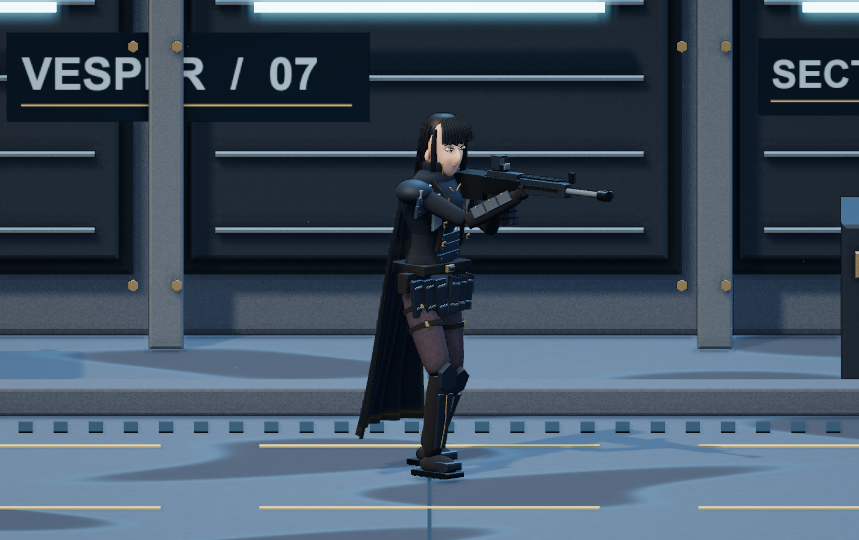
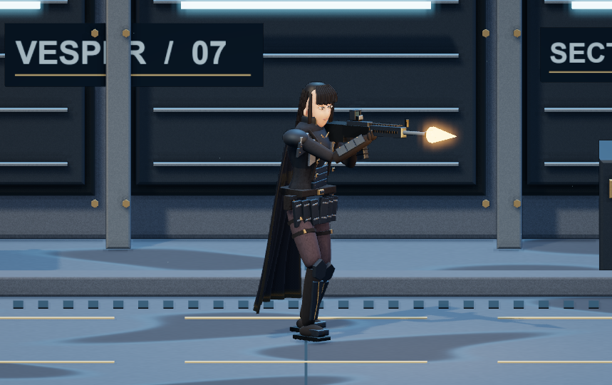

# 플랜 F 003 사격 자세·반동

2026-11-12 KST · 구현·접점·조작 검사 통과, 동작 미감은 사용자 검수 대기.

[실행](http://127.0.0.1:4173/#/samples/characters/clone_01?plan=f) · [이전 002 모델·광원](../procedural_002/README.md)

사용자 요청: “총쏘는 자세 반동 모션에 대해서 개선.”

몸통을 약간 틀고 상체를 앞으로 기울이며 무릎을 굽힌 사격 자세로 바꿨다. 정지 시 발을 앞뒤로 벌리고 이동 시 보행으로 연결한다. 머리는 총 방향을 향하고 조준 자세에서 조금 더 숙인다. 프로젝트의 [사격 자세 조사](../../../../../../docs/35-firing-form-reference-research.md)·[기존 적용 기록](../../../../../../docs/firing-form-application-001.md)을 자세 구성 참고로 사용했다.

개머리판의 뒤쪽 접점을 어깨 기준에 맞춘 다음 총을 회전시킨다. 오른손은 손잡이, 왼손은 손보호대 뒤쪽 접점을 따라가며 팔꿈치는 두 관절 IK로 계산한다. 상체를 틀어 왼팔이 닿는 범위를 확보했다. 두 다리도 같은 방식으로 무릎 위치를 계산하므로 몸이 낮아질 때 발을 고정한 채 굽혀진다.

발사할 때 총에 빠른 충격을 주고, 상체와 머리는 더 느리게 반응한다. 정확해를 쓰는 감쇠 스프링과 60Hz 고정 갱신으로 연사 중에도 안정적으로 복귀한다. 머리카락·망토에는 상체와 머리 반응의 차이를 작은 후속 움직임으로 더했다. 이것은 연출용 절차 모션이며 실제 총기나 인체의 물리 재현은 아니다.

조작은 A/D·방향키 이동, Space/J·누르고 사격 버튼으로 연사한다. **단발** 버튼은 한 번 발사하고, **재생 0.25×**는 이동·반동·화염·탄흔의 시간을 함께 느리게 한다. 소리 자체의 재생 음높이는 바꾸지 않는다. 정지 중 단발을 누르면 재생을 재개하며 한 발을 발사한다.

변경 구현은 `game/plan-f/model.js`, `weapon-pose.js`, `simulation.js`와 공통 탭 조작부다. 외부 모델·모션·텍스처 없이 기존 코드 생성 경로를 유지한다. 002 소스는 `../procedural_002/source_snapshot/`에 보존했다. 001·002 기록과 원본·다른 플랜은 유지한다.

검사는 Chrome 157에서 수행했다. [UI 결과](review/result.json)는 단발 1회, 0.25× 발사 간격, 좌우 이동·이동 사격·입력 해제·정지·초기화·탭 복귀·좁은 화면을 포함한다. 페이지/콘솔 오류와 GLB/FBX 요청은 0건이다. [접점·시간 검사](review/recoil-check.json)는 실제 생성 리그의 720프레임에서 손-총과 팔/다리 연결을 확인했다. 최대 오차는 부동소수점 범위였으며 8초 연사 80발과 해제 후 안정화를 확인했다. 단발 최대 반응 시각은 총 약 17ms, 상체 약 67ms, 머리 약 200ms다. 렌더 함수를 반복 호출해도 시뮬레이션 상태는 변하지 않았다.

[200ms 복귀](review/recoil-frame-12.png) · [1초 뒤](review/recoil-frame-60.png)

관절과 손의 기준점 검사는 표면 전체의 무간섭을 보장하지 않는다. 손가락별 파지·손바닥 압착·견착부 옷 변형·천 충돌은 구현하지 않았다. 총기·손·얼굴의 모양과 반동 강도는 사용자 검수 대기다. 정확한 변경 소스·해시·기록 시각은 [record.json](record.json)에 남겼으며 외부 생성 호출 0회, 총 작업 시간·비용은 측정하지 않았다.
