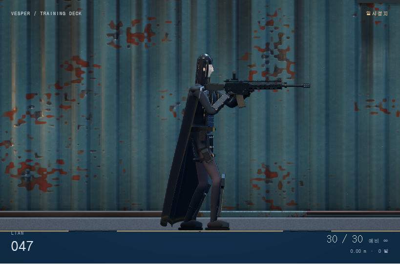

# 플랜 F · 오른손 방아쇠 파지 수정 003

2026-11-12 · 사용자 지정: “오른손 잡이라 트리거를 오른손으로 잡아야함”.

[실행](http://127.0.0.1:4173/#/samples/characters/clone_01?plan=f&fYaw=0&fPitch=0)

캐릭터의 로컬 전방은 +Z, 위는 +Y이므로 몸 기준 오른쪽은 **−X**다. 기존 코드는 +X 팔에 방아쇠 역할을 부여해 실제로는 왼손잡이 배치였다. `anatomy.js`에서 오른쪽 −1·왼쪽 +1을 명시하고 이 기준으로 파지와 장전 역할을 통일했다.

- 오른손은 방아쇠 손잡이, 오른손 검지는 방아쇠 동작을 담당한다.
- 왼손은 앞쪽 받침, 탄창 교환, 노리쇠 조작을 담당한다.
- 오른쪽 견착 위치·상체 기본 비틀림·팔꿈치 방향·좌우 손 접점과 왼쪽 파우치 경로를 함께 조정했다.
- 손가락 배열을 양손에 맞게 반영해 검지가 각 손의 엄지 쪽에 놓이게 했다.
- 이동 방향을 바꿀 때 캐릭터 전체가 회전하며 오른손/왼손 역할은 바뀌지 않는다. 중립 보기와 기존 장전 시간·탄약 규칙을 유지한다.

## 확인

설치된 Chromium에서 실제 런타임을 실행했다. 앞선 작업에서 내장 브라우저 연결이 실패했으므로 같은 로컬 Playwright 경로를 사용했다.

- 좌/우 진행 × 서기/앉기 × 대기/탄창 교환/노리쇠/장전 복귀의 **16개 자세**에서 몸 기준 오른쪽 어깨임을 전방×위 벡터로 확인했다. 오른손은 항상 방아쇠 접점에, 대기 시 왼손은 받침 접점에 일치한다.
- 발사 상태에서 오른손 검지 각도만 방아쇠 동작으로 변하고 왼손 받침 손가락 각도는 유지된다.
- 이전 외피 회귀 검사의 13개 표본 자세도 통과했다. 이는 접점/변형 검사이며 손가락 전체의 총 표면 접촉과 무관통을 보장하지 않는다.
- 실제 측면·정면 캡처와 오류 기록을 `reviews/`에 보존한다. 외형 세부는 사용자 검수 대기다.

[정면](reviews/right-trigger-front.png) · [손 역할 검사](reviews/hand-checks.json) · [외피 검사](reviews/body-checks.json)

작업 전 소스는 `before/`, 수정 후 소스는 `source_snapshot/`, 해시는 `record.json`에 보존한다. 기존 원화·다른 플랜·무기 단독 모델을 변경하지 않았다.
