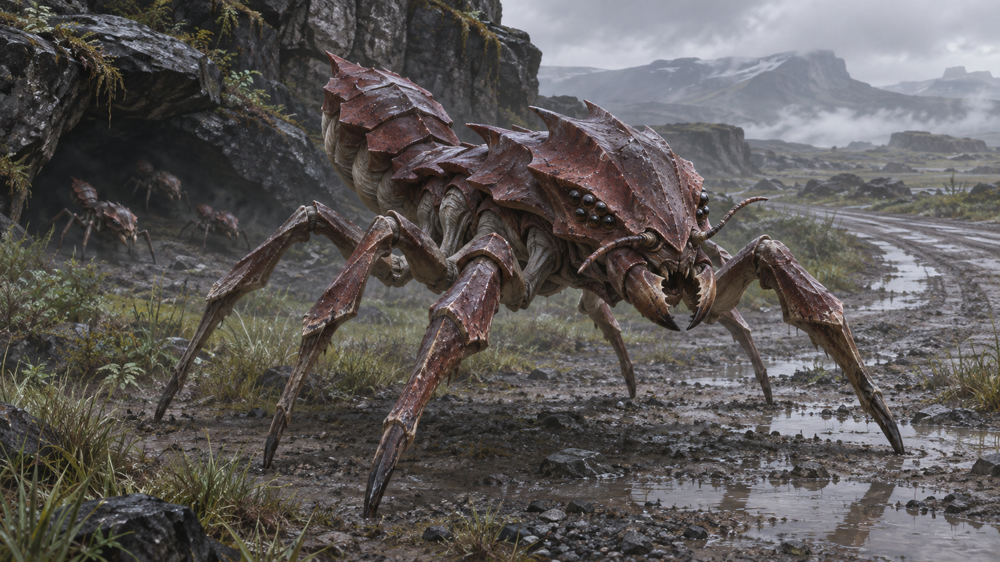

# 베스퍼 군락형 곤충 크리처 · 컨셉 001

2026-11-09 대화에서 생성한 첫 원화와 컨셉을 사용자 요청으로 함께 보관한다. **보관된 컨셉 시안**이며 최종 종명·외형·생태의 채택은 별도다.

## 사용자 지정 방향

- 베스퍼의 토착 생명체이며, 작은 개체들이 군락을 이루는 곤충형 크리처다.
- 저글링은 작은 군집 근접 개체라는 크기·역할의 참고이며 외형을 따라 하지 않는다.
- 이후 사용자가 제시한 스타쉽 트루퍼스의 괴물을 참고해, 각진 관절 다리와 큰턱을 지닌 외계 곤충의 위협감을 탐색했다.
- 현무암 갑주를 두른 짐승형, 사마귀 중심의 단독 포식자안, 납작한 쐐기형 벌레안은 사용자가 반려한 이전 제안이다. 그 이름과 외형을 이번 개체에 승계하지 않는다.

## 이번 원화의 외형 컨셉

| 요소 | 제작 목표와 제안 |
|---|---|
| 규모 | 몸길이 약 1m, 서 있을 때 성인 허벅지 아래 높이를 목표로 한 소형 개체. 원화에는 사람·척도가 없어 실제 비례를 확정할 수 없다. |
| 몸통 | 짧은 가슴과 분절된 배. 경계할 때 뒤쪽 배를 위로 치켜든다. |
| 다리 | 좌우 세 개씩, 총 여섯 개의 길고 각진 관절 보행 다리. 몸통과 다리 사이의 빈 공간이 잘 보이는 실루엣. |
| 머리 | 몸에 비해 크고 앞으로 돌출된 머리, 짧은 감각 더듬이, 양옆에 모인 작은 검은 눈. |
| 입 | 짧고 굵게 맞물리는 큰턱. 가까이 붙어 물어뜯는 근접 전투 개체라는 인상. |
| 외피 | 짙은 적갈색 키틴질 갑각, 마모와 거친 판 경계, 관절·배 아래의 옅은 회백색 연결 조직. |
| 동작 인상 | 앞몸을 낮추고 배를 든 경계 자세에서 빠르게 접근할 것 같은 긴장감. 실제 모션은 제작하지 않았다. |
| 군락 표현 | 전경의 한 개체를 크게 보여 주고 뒤쪽 바위틈에는 같은 형상의 여러 개체를 배치한다. |

프롬프트의 해부학·크기 수치는 제작 목표이며, 생성 결과의 정확한 관절 수·길이·축척을 측정해 보증한 규격이 아니다. 원본은 수정·재인코딩·크롭하지 않는다.

## 군락과 전투의 보완안

군락의 흔한 소형 전투 개체라는 역할을 제안했다. 여러 방향에서 접근하고, 주변 개체가 계속 유입되어 숫자로 압박하는 장면을 상정한다. 지면과 바위 벽을 나눠 타는 접근, 큰턱을 이용한 공격, 경계 자세가 군집으로 번지는 장면은 **행동 제안**이다.

정식 종명·개체 호칭·군락 규모·번식·계급 분화·여왕 유무·신호 전달 방식·지능·갑각 방호력·약점은 미정이다. 군락성만으로 통합 지성이나 지적 외계 문명을 확정하지 않는다. 기존 통신 방해의 원인종으로도 지정하지 않는다.

## 배경과 연출

베스퍼의 비·안개가 있는 온대 개척 전선, 젖은 도로와 웅덩이, 회녹색 식생, 침식된 현무암 바위틈을 배경으로 삼았다. 현무암은 이 장면의 차가운 지형이며 현재 용암 활동·용암 내성을 뜻하지 않는다.

사실적인 게임 크리처 컨셉 아트로 제작했다. 게임용 도트·투명 컷아웃·정투영 규격·3D 모델·리그·스프라이트·모션은 없다. 기존 게임의 `swarm_creature_melee` 외형이나 수치를 교체하지 않고, 별도 보관 ID `vesper_colony_insect`로 등록한다.

## 원본과 제작 기록

- [PNG 원본](source/illustration.png)
- [실제 영어 프롬프트](records/prompt.md) · [정확한 도구 입력 JSON](records/prompt.json)
- [생성·보관 기록](records/generation.json)
- [원본 복사·디코드·해시 확인](records/archive-verification.json)
- [통합 샘플의 정지 원화 보기](http://127.0.0.1:4173/#/samples/enemies/vesper_colony_insect?rev=illustration_001)

내장 `image_gen.imagegen`을 한 번 사용해 생성한 원본을 보존했다. 모델명·seed·비용·정확한 호출 시작/종료 시각은 도구에서 확보하지 못했으므로 기록에 null로 둔다. 파일 수정 시각과 실제 보관 시각은 출처를 구분해 기록한다.

설정 근거: [세계관 4.3·14장](../../../../../docs/15-worldbuilding.md), [기존 적 제작 기준](../../../../../docs/11-enemies-and-factions.md). 이번 시안의 보관은 기존 게임 적의 제작 기준이나 세계관의 종별 세부 설정을 대체하지 않는다.

