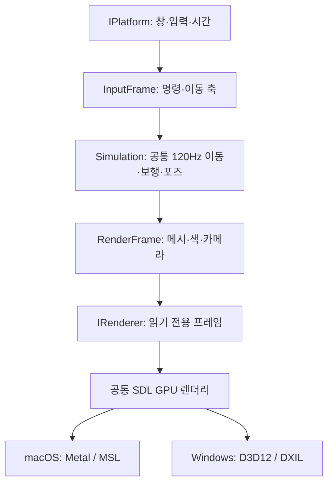

# 플랜 D · Windows/macOS 공통 구조 002

[문서 목록](../README.md) · 2026-11-07 KST · [실행 안내](../native/plan-d/README.md) · [검수 기록](../art/characters/clone_01/motion/plan_d/architecture_002/README.md)

사용자 요청은 “메인 움직임 로직과 랜더링은 추상화되서 윈도우/맥 둘다되게 구조를 잡을 수 있어?”다. 공통 동작과 화면 생성, 플랫폼 구현의 경계를 실제 코드와 CMake 타깃으로 분리했다. Windows 실행 확인은 아직 없으며 이번 작업의 완료 범위는 공통 구조와 Mac에서의 기존 결과 유지다.

## 구조와 책임

| 계층 / CMake 타깃 | 포함 범위 | 의존 경계 |
|---|---|---|
| `plan-d-core` | `Simulation`, `InputFrame`, 뼈대, 메시·HUD·카메라 계산 | 표준 C++20만 사용. SDL·Metal·D3D 헤더/링크 없음 |
| `plan-d-app` | 명령행 설정, 공통 실행 루프, 캡처 요청 | 코어와 `IPlatform` / `IRenderer`만 사용. SDL 링크 없음 |
| `plan-d-sdl` | SDL 창·입력·시간, 공통 SDL GPU 그리기·PNG | 네이티브 핸들·GPU 타입은 이 구현 안에 둠 |
| 플랫폼 설정 파일 | 드라이버 이름·셰이더 형식·파일 경로 | CMake가 Metal 또는 D3D12 설정 하나만 컴파일 |
| `main.cpp` | SDL 프로세스 진입점, 런타임 팩토리 선택 | 게임 갱신이나 그리기 로직 없음 |

`Simulation::advance()`는 공통 명령과 경과 초를 받아 120Hz로 움직임을 계산한다. 렌더링 주기와 분리했으며 일시정지 시 이동 시간은 멈추고 카메라는 조절할 수 있다. `Simulation::renderFrame()`은 `const`로 현재 뼈대에서 메시·카메라를 만든다. `IRenderer::draw()`도 읽기 전용 프레임을 받으므로 움직임이나 포즈 시간을 갱신하지 않는다.

SDL 키·마우스 이벤트는 `SdlPlatform`에서 `InputFrame`의 논리 명령과 -1~1 이동 축으로 바꾼다. 탭의 클릭 판정은 공통 UI 좌표 계산으로 옮겼다. 코어에 Windows/macOS 조건문이나 SDL 키 코드를 넣지 않는다. 네이티브 창은 공통 인터페이스에 노출하지 않고 런타임 팩토리 안에서 GPU 구현과 연결한다. 종료 시 렌더러가 창보다 먼저 파괴되도록 수명 순서를 고정했다.

## 두 운영체제의 렌더링

메시 업로드·깊이 테스트·조명 파이프라인·그리기·화면 출력·캡처 코드는 `SdlGpuRenderer` 한 곳을 공유한다. Metal과 D3D12의 API 차이는 SDL GPU가 처리한다. 플랫폼 설정 파일은 백엔드와 셰이더 형식만 선택한다. 이는 별도 Metal/D3D 렌더러 두 개를 직접 구현한 구조가 아니다. [SDL GPU 공식 설명](https://wiki.libsdl.org/SDL3/CategoryGPU)

macOS는 `basic.metal`을 실행 시 컴파일한다. Windows는 같은 입출력·변환·조명 식을 가진 `basic.hlsl`을 DXC로 DXIL로 빌드한다. 이번에는 셰이더 자동 변환기를 추가하지 않았으며 두 셰이더는 동일한 버텍스·유니폼 규약을 유지해야 한다. 셰이더 변경은 실행 파일 재링크와 무관하게 빌드 출력 폴더에 갱신되도록 별도 산출물 의존성을 설정했다.

Windows 실행 진입점은 `native/plan-d/run-windows.ps1`이다. SDL의 Windows 진입점 처리는 얇은 `main.cpp`의 `SDL_main.h`에서 맡는다. [SDL 진입점 안내](https://wiki.libsdl.org/SDL3/README-main-functions)

## 이번 확인

1. `PLAN_D_BUILD_VIEWER=OFF`인 별도 디렉터리에서 SDL 탐색·다운로드 없이 코어를 빌드했다.
2. 작은 검사 실행 파일 한 번으로 30/144Hz 표시 주기에서 동일한 1초 이동·포즈, 일시정지와 카메라의 독립, 렌더 프레임 생성의 상태 불변을 확인했다.
3. Mac 전체 빌드 후 Metal 창을 3프레임 실행하고 overlay PNG 한 장을 내려받아 눈으로 확인했다. 최초 `preparation_001`의 같은 설정 PNG와 `cmp` 종료 0으로 바이트까지 같았다.

모든 빌드는 Apple Clang 21·SDL 3.4.20의 macOS 환경이다. 이것이 MSVC/DXC 빌드나 Windows GPU·입력·배포 확인을 대신하지 않는다. 전체 테스트·브라우저 검사·성능 측정은 하지 않았다. 동작 확인을 위한 기존 단순 인체·사인파 보행을 재사용하며 캐릭터 외형·새 모션은 추가하지 않았다.

변경 전 소스는 `architecture_002/records/runtime-before.tar.gz`에, 새 캡처와 실행 출력·해시는 같은 새 버전 경로에 보존했다. `preparation_001` 기록을 소급 변경하지 않는다.
